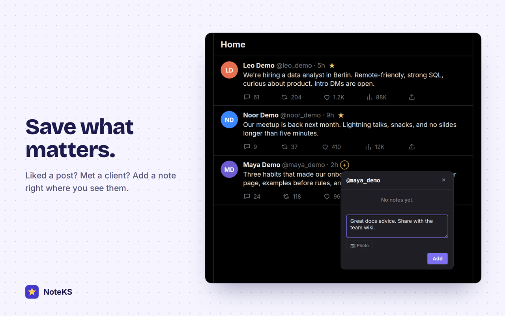
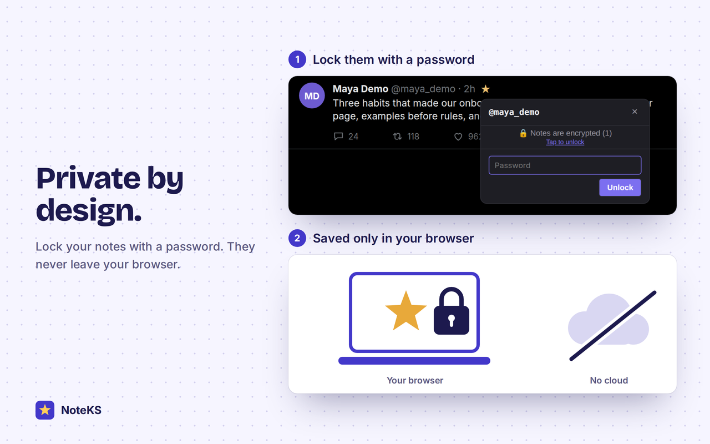
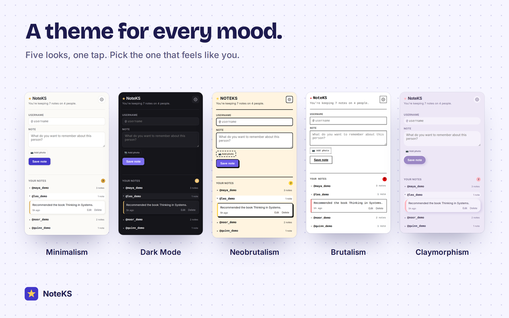

# NoteKS

Private notes on the people you come across on x.com.

A small ★ appears next to anyone you have a note on, so you never have to wonder who they are or why you saved them. Click it to read, add, edit or delete notes, right on the page.

> NoteKS is an independent project. It is not affiliated with, endorsed by, or sponsored by X Corp.

<p>
  
  
</p>
<p>
  
</p>

*The feed behind the extension in these images is a mock-up with fictional accounts. The NoteKS interface in front of it is the real extension.*

## Features

- **Notes where you meet people.** A ★ marks people you have notes on, and a faint + marks people you do not, so adding a note is one click. Hover the ★ for a quick preview.
- **Photos and links.** Attach a photo to a note, and `http(s)` links in notes are clickable.
- **Edit and delete** any note, from the page or from the popup.
- **Folders by person.** The popup lists people, and opening one shows everything you wrote about them.
- **Your own icon.** Use the star, an emoji, a short piece of text (up to 4 characters), or an image.
- **Five themes:** Minimalism, Dark Mode, Neobrutalism, Brutalism, Claymorphism.
- **Optional encryption** for note text and photos.
- **Backup.** Export all notes to a JSON file and import them back.
- **Report & Feedback** link that pre-fills a Google Form with technical details (see [Privacy](#privacy)).

## Install

**Chrome Web Store:** coming soon. The link will be added here.

**From source** (Chrome, Brave, Edge and other Chromium-based browsers):

1. Download or clone this repository.
2. Open `chrome://extensions` and turn on **Developer mode**.
3. Click **Load unpacked** and choose the folder that contains `manifest.json`.
4. Open x.com. A ★ or a faint + appears next to names.

Built and tested on Brave (Windows) and Chromium (Linux).

## Privacy

- Notes, photos, settings and the encryption key never leave your browser. The extension makes no network requests, has no accounts, no analytics and no ads.
- The only thing that can leave your device is what **you** submit through the optional Report & Feedback form: it opens a Google Form in a new tab with your browser and OS, the extension version, and the last error message pre-filled. Nothing is sent until you press Submit, and your notes are never included.

Full text: [privacy policy](https://who317.github.io/noteks/privacy.html) (source: [`docs/privacy.html`](docs/privacy.html)).

## Encryption: what it covers and what it does not

When you turn encryption on:

- Note **text** and **photos** are encrypted with AES-256-GCM. The key is derived from your password with PBKDF2-SHA-256 (200,000 iterations) and a random salt, and every value gets its own random IV.
- Your password is never stored. While unlocked, the derived key is kept in `chrome.storage.session` (memory only, cleared when the browser closes) and locks again after 2 minutes without use.
- **Usernames and creation times are not encrypted.** Someone with access to your browser profile can see *which* accounts you have notes about, but not what the notes say.
- **A forgotten password cannot be recovered.** There is no reset.
- Export and import are disabled while encryption is on. Remove encryption first if you want a plain backup.

## Permissions

| Permission | Why |
| --- | --- |
| `storage` | Keeps notes and settings in `chrome.storage.local`, and the temporary unlock key in `chrome.storage.session`. |
| `https://x.com/*` | The content script reads usernames on the page to place the ★ and + badges. It has no access to any other site. |
| Background service worker | One call to `chrome.storage.session.setAccessLevel()`, which Chrome requires before content scripts may read the session-storage unlock key. It also records error messages for the report form. |

## Project layout

```
manifest.json
src/
  background.js      service worker: session-storage access, error capture
  content.js         badges, hover preview and note panel (Shadow DOM), runs on x.com
  content.css        badge styles for the page
  popup.html/css/js  popup: notes by person, settings, backup, report link
  themes.css         theme variables shared by the popup and the page
icons/
docs/                GitHub Pages: landing page and privacy policy
store/               promo images for the Chrome Web Store listing
```

There is no build step and there are no dependencies. Plain JavaScript and CSS.

## Known limitations

- **It depends on the page's markup.** Badges are placed using `data-testid` attributes on x.com. If the site renames them, badges stop appearing until the selectors are updated. All of them live in one `SELECTORS` object at the top of `src/content.js`.
- **The floating note panel is not clamped to the window edge**, so in a very narrow window it can extend past the right side.
- **Notes live in this browser only.** Uninstalling the extension deletes them. Loading an unpacked copy from a different folder is treated by Chrome as a different extension, with its own empty storage. Export a backup before moving or reinstalling.
- **The crypto code is duplicated** in `popup.js` and `content.js` because they run in different contexts. Keep them in sync when changing either.

## Reporting bugs and ideas

Use **Report & Feedback** in the extension's settings panel, or [open an issue](https://github.com/who317/noteks/issues). Please do not paste personal information or the contents of your notes into an issue. For security problems see [SECURITY.md](SECURITY.md).

## Contributing

See [CONTRIBUTING.md](CONTRIBUTING.md).

## License

[MIT](LICENSE)
